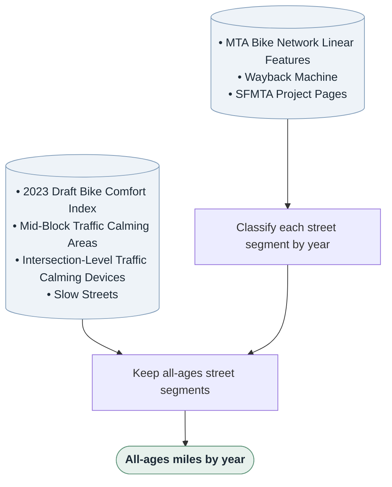
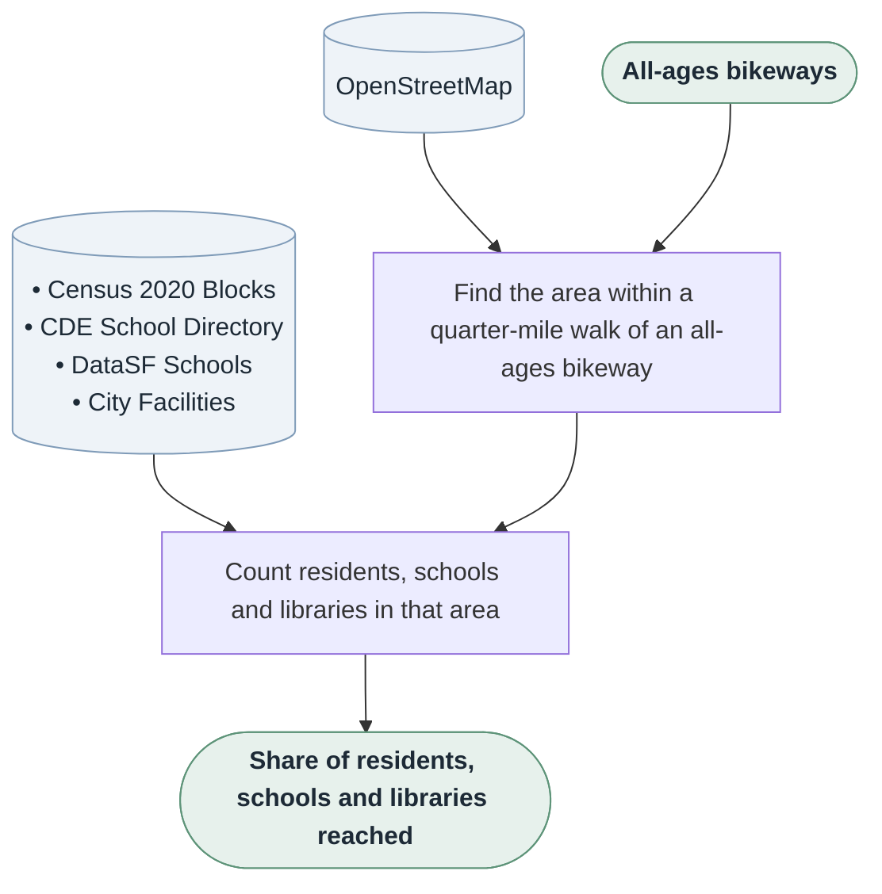
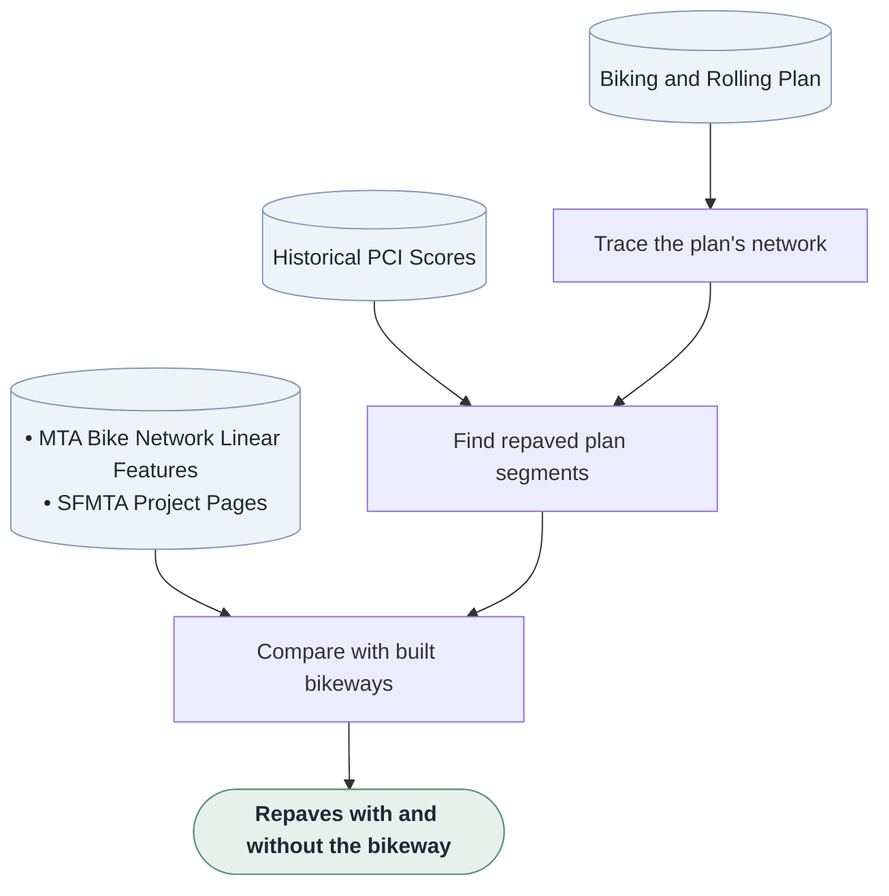
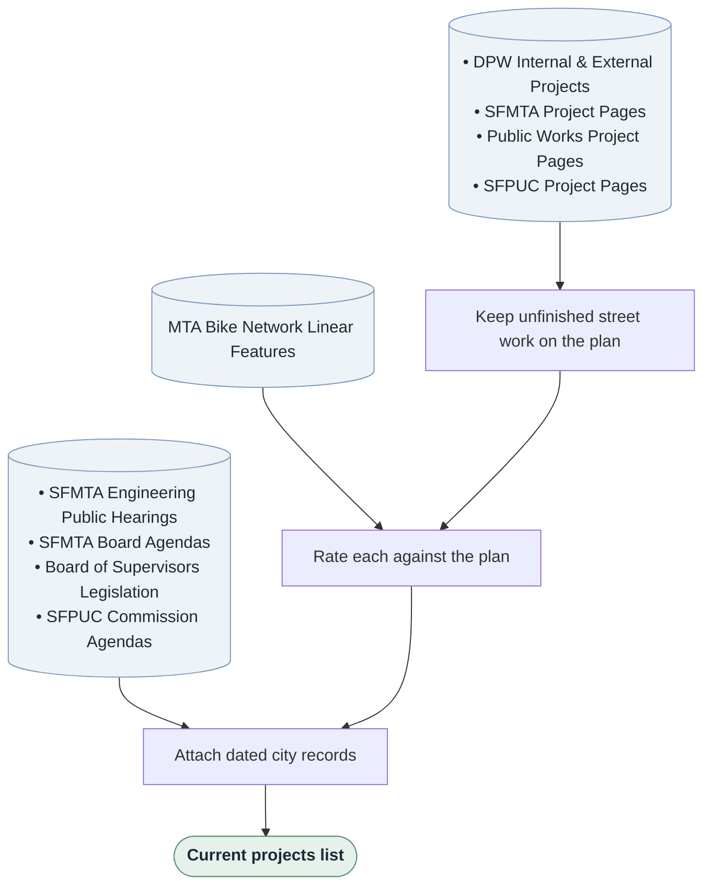

# About the Data

{.lede} Here's how we analyzed public data to generate this report. We tried to stay faithful to the [Biking and Rolling Plan]({{ planUrl }})'s definitions and use the most up to date and complete datasets, where the city's data allowed; however, we did note some issues along the way.

## Issues {#issues}

{.issues}
1. {#issue-2} **SFMTA's [bikeway layer on DataSF](https://data.sf.gov/d/ygmz-vaxd) is out of date.** It shows no bikeways since {{ layerLatest }}, so we filled in newer work from [SFMTA Project Pages](https://www.sfmta.com/projects).
2. {#issue-history} **SFMTA doesn't keep old versions of the layer.** So we rebuilt past years from [copies saved on the Internet Archive](#years), starting with [the first one]({{ firstArchiveUrl }}).
3. {#issue-12} **Bike Comfort Index.** The only scores online are the [2023 Draft]({{ bciUrl }}), so we used those for every year.
4. {#issue-4} **Slow Streets.** The [dataset](https://data.sf.gov/d/hkz3-itiu) stops at {{ slowStreetsAsOf }} and drops removed streets, so we traced the full history from SFMTA Board reports from [2020](https://www.sfmta.com/media/23090/download?inline), [2021](https://www.sfmta.com/media/26282/download?inline) and [2022](https://www.sfmta.com/media/33575/download?inline).
5. {#issue-5} **Traffic calming.** The city doesn't publish traffic speed or volume by street, so we counted a street as [calmed](#calmed) when it's a [Slow Street](https://data.sf.gov/d/hkz3-itiu) or has [mid-block](https://data.sfgov.org/d/abhw-ffzx) or [intersection](https://data.sfgov.org/d/bp3t-bd4t) calming built.
6. {#issue-10} **The plan's network map.** The city doesn't publish it as a map file, so we [traced it](#trace) from [the plan's PDF]({{ planUrl }}).

## How We Did the Analyses {#method}

### Terms {#terms}

{.terms}
- **Class I to IV** are the state's bikeway classes:
  - **Class I:** a path away from cars, like the Panhandle.
  - **Class II:** a painted lane.
  - **Class III:** a signed route shared with cars, often marked with a sharrow (a painted bike symbol).
  - **Class IV:** a lane separated from cars by posts, parking or a curb.
- **Bikeway layer** is SFMTA's map file of every bikeway, with one row for each street segment and direction of travel.
- **Bike Comfort Index (BCI)** is SFMTA's score, from 4 to 146, of how comfortable a street is to ride ([Appendix E]({{ appendixUrl }})). The plan reads a score over 80 as "comfortable to ride for most users" (Appendix G). The published scores are the 2023 draft, on SFMTA's [Active Communities Plan map]({{ bciMapUrl }}).
- **North Star network** is the plan's map of the finished network. Its street list, **Appendix L**, says to "defer to the map" where the two disagree.
- **Miles** count each direction of travel, the way the plan counts them, so a lane each way counts twice.
- **Coordination feed** is Public Works' public list of the street work every department has planned.

### Improving the Bike Network {#overview}

The overview uses SFMTA's [bikeway layer]({{ layerUrl }}) and {{ archiveCount }} archived copies of it. For work after {{ layerLatest }}, we use [SFMTA's project pages](https://www.sfmta.com/projects).

#### Miles and the All-Ages Test {#definitions}

The plan counts 472 miles of network ([p. 20]({{ planUrl }})), and the bikeway layer has {{ netEnd }}. A street segment counts as all-ages if it meets one of the criteria below ([p. 24]({{ planUrl }})):

<table>
  <thead><tr><th>Bikeway</th><th>Counts as all-ages when</th></tr></thead>
  <tbody>
    <tr><td>Class I path, Class IV separated lane, Slow Street</td><td>Always</td></tr>
    <tr><td>Class II painted lane</td><td>BCI over {{ bciThreshold }}</td></tr>
    <tr><td>Class III signed route</td><td>BCI over {{ bciThreshold }} and traffic calming built</td></tr>
  </tbody>
</table>

A street segment with no score doesn't count ({{ bciUnscoredMiles }} miles). Calming means a measure in the city's [mid-block](https://data.sfgov.org/d/abhw-ffzx) or [intersection](https://data.sfgov.org/d/bp3t-bd4t) calming records. By these criteria, {{ cmpOurs }}% of residents were within reach in {{ cmpYear }}. The plan reports {{ cmpPlan }}% ([Appendix G]({{ appendixUrl }})).

#### Past Years {#years}

For each past year, we use the first archived copy saved after it. If a street segment's update year is later than that, we date the change to the update year.

{{# snapshotsTable }}

{{# yearsTable }}

Before {{ firstArchive }}, the figures could be off in either direction. {{ unknownMiles }} miles in {{ firstYear }} have no known class, so that year's figure may be low. And {{ preClassIV }} miles of Class IV carry an install year before [AB 1193](https://leginfo.legislature.ca.gov/faces/billNavClient.xhtml?bill_id=201320140AB1193) created the class in 2014, so that figure may be high.

#### Removed Bikeways and Slow Streets {#removals}

A street segment counts as removed from the first archived copy that doesn't have it. We can't see anything removed before the first copy.

The pandemic Slow Streets come from SFMTA Board staff reports from [July 2020](https://www.sfmta.com/media/23090/download?inline), [April 2021](https://www.sfmta.com/media/26282/download?inline) and [December 2022](https://www.sfmta.com/media/33575/download?inline). They list where each corridor ran and which ones the city kept. A dropped street segment counts as all-ages from the year its corridor opened through {{ pandemicLastYear }}, so {{ pandemicDropped }} miles leave the total in {{ pandemicYear }}. We leave out {{ unaccountedCount }} corridors the reports don't map, plus Lombard Street.

#### Work Finished in {{ lastYear }} {#reported}

These bikeways count in {{ lastYear }} because their SFMTA project page, read {{ reportedRead }}, says the work is complete or substantially complete:

{{# reportedItems }}

All {{ reportedCount }} are separated bikeways, {{ reportedMiles }} miles in all. We take the bikeway type from each project page.

#### Planned Projects {#planned}

The dashed lines on the overview map are bikeway projects that SFMTA's pages still list as coming, in the year each page gives for finishing. A project with no date, no bikeway type, a date that has passed, or a pause doesn't add any miles.

#### Who the Network Reaches {#reach}

A census block is within reach when its street frontage is a quarter-mile walk ({{ quarterFt }} feet) from an all-ages bikeway. A school or library is within reach when the building itself is ([p. 24]({{ planUrl }}); [Appendix G]({{ appendixUrl }})). We walk along the streets, stairways and paths in [OpenStreetMap](https://www.openstreetmap.org/copyright), read {{ walkRead }}. The overview also shows one block ({{ blockFt }} feet), two blocks ({{ twoBlockFt }} feet) and 1,000 feet, the walk to a protected bikeway the [ITDP Atlas](https://atlas.itdp.org/) measures.

Residents come from the 2020 census. For other years, we spread American Community Survey estimates over blocks by their 2020 shares. Schools are the {{ schoolsNow }} K-12 schools open on 1 September: {{ schoolsCde }} public schools from the California Department of Education and {{ schoolsPrivate }} private schools from [DataSF's Schools](https://data.sf.gov/d/7e7j-59qk). Libraries are the branches plus the Main Library. We measure the Muni and parking figures the same way, to the nearest of {{ muniStops }} Muni stops and to the nearest block with on-street parking ({{ parkingSpaces }} spaces, from a survey done {{ parkingFrom }} to {{ parkingTo }}).

#### The Definition Explorer {#explorer}

The explorer recomputes reach in your browser from the same {{ lastYear }} data, for {{ residentsTotal }} residents ({{ residentsSource }}). It opens on the North Star network, with each plan type set to the closest choice: Separated as a separated lane, Car-free and Shared-use Path as a path, and Shared as a Slow Street. Segments the plan marks [Shared Level III or Undecided](#classes) never count.

#### The Goal Line {#north-star-goal}

{#directions} The goal is the plan's {{ planMiles }} miles, using today's all-ages miles on any street segment where those are higher, plus the {{ offPlanMiles }} all-ages miles we have today off the plan. That's {{ goalMiles }} miles. At the {{ paceFrom }} to {{ paceTo }} average of {{ paceMiles }} miles a year, the city would finish in {{ goalYear }}.

#### Project Names on the Map {#projects-credit}

When a street segment gained an all-ages bikeway since {{ firstYear }}, we name the SFMTA bike project whose map line is within {{ lineToleranceFt }} feet of it and whose page gives a date within a year. {{ attributedMiles }} miles go to {{ attributedProjects }} projects and {{ standInStreets }} Slow Streets, and {{ unattributedMiles }} to none.

### Better Coordination {#departments}

#### Which Segments Count as Repaved {#repaved}

{#repaving} A street segment counts as repaved on the day its score in the city's [pavement records](https://data.sf.gov/d/78va-8dhi) resets to 100. Since the plan was adopted on {{ adoptedLong }}, the city has repaved {{ repavedSinceAdoption }} plan segments. [Better coordination](/transportation/bike#coordination) counts the {{ onPlan }} whose bikeway type the plan names, and leaves out the {{ undecidedSegments }} [marked Undecided](#undecided). We check what's on the street against SFMTA's copy of its bikeway layer, last edited {{ bikewayLayerAsOf }}, plus work its project pages say is finished since. {{ checkable }} segments were repaved before that edit, and {{ checkableShortfall }} of them fall short of the plan. We can't check the other {{ unverifiable }} yet.

#### The Plan's Network, Traced {#trace}

We couldn't find a map file of the plan's network on DataSF, ArcGIS Online or SFMTA's map server (checked 29 September 2026). So we traced the North Star map from the plan's PDF onto the city's street map. Half the traced lines sit within {{ registrationMedianFt }} feet of the printed line, and 90% within {{ registrationP90Ft }} feet. It's the best we can do until the city publishes the file.{{# communityPlansLink }}

#### What the Plan Means by Each Class {#classes}

Action 2.7.1 commits SFMTA to "{{ definitionsPendingQuote }}" (printed pages {{ definitionsPendingPage }}). So these descriptions, from printed pages 74 to 77, aren't final yet:

{{# definitionsTable }}

Shared Level III is the only shared level the plan doesn't call all-ages. The plan says: "{{ l3Ceiling }}" (printed pages {{ l3CeilingPage }}).

#### Is a Shared Street Calmed? {#calmed}

The plan's Shared levels ask for low car speed and volume, but the city doesn't publish either by street. So we count a street as calmed when it's a [Slow Street](https://data.sf.gov/d/hkz3-itiu) like Page Street, or has [mid-block](https://data.sfgov.org/d/abhw-ffzx) or [intersection](https://data.sfgov.org/d/bp3t-bd4t) calming built. Of the {{ sharedSegments }} repaved Shared segments:

<table>
  <tbody>
    <tr><td>On an implemented Slow Street</td><td class="num">{{ onSlowStreet }}</td></tr>
    <tr><td>Traffic calming built, but not a Slow Street</td><td class="num">{{ calmingOnly }}</td></tr>
    <tr><td><strong>Neither</strong></td><td class="num"><strong>{{ neither }}</strong></td></tr>
  </tbody>
</table>

#### The {{ undecidedSegments }} Segments Marked Undecided {#undecided}

{{ undecidedMiles }} repaved miles fall where the plan's map says Undecided. The plan never defines that label, so no figure includes them. {{ undecidedNothing }} have no bikeway, {{ undecidedOnlySharrow }} have only a sharrow, and {{ undecidedPaintedOrBetter }} has a painted lane or better.

#### What the Law Requires {#law}

[Public Works Code §2.4.13](https://codelibrary.amlegal.com/codes/san_francisco/latest/sf_publicworks/0-0-0-4453) requires a repaving project to include the measures in an adopted bicycle or pedestrian safety plan "to the maximum extent practicable and feasible". The city decides what's practicable, so we don't say it broke the law.

#### Street Work Since the Plan and Through {{ ovHorizonYear }} {#since-plan}

```mermaid
flowchart TD
  n0["Find plan segments without the plan's bikeway"]
  dn0[("MTA Bike Network Linear Features")] --> n0
  class dn0 src
  n1["Match each to its first street work"]
  dn1[("• Historical PCI Scores<br>• DPW Internal & External Projects<br>• SFMTA Project Pages")] --> n1
  class dn1 src
  n2(["Missing miles by street work"])
  n0 --> n1
  n1 --> n2
  classDef src fill:#eef3f8,stroke:#7f9bb8,color:#1d2a36
  classDef res fill:#e7f1ec,stroke:#5e9479,color:#1d2a36,font-weight:bold
  class n2 res
```

We count each street segment on the plan that's missing its bikeway once, under the first street work on it: a repave since {{ pastFromLong }}, or a Public Works or SFPUC job starting by the end of {{ ovHorizonYear }}. We leave out spot repairs ({{ ovSpotMiles }} miles), later jobs ({{ ovLaterMiles }} miles) and SFMTA's own projects ({{ ovSfmtaMiles }} miles). {{ ovSharedNone }} of the {{ ovMiles }} miles are Shared segments that might already meet the plan.

{#lever} **The repaving rate** is the share of repaved street segments on the plan that got the plan's bikeway that year or the next. No record says how often a sewer or water job brings a bikeway, so we only apply it to repaving.

### Current Repaving Projects {#projects}

[Current Repaving Projects](/transportation/bike/projects) lists the unfinished SFMTA, Public Works and SFPUC street projects on the plan's network.

**Which projects.** We read the [coordination feed]({{ feedUrl }}) ({{ feedJobs }} jobs on {{ feedQueried }}), SFMTA's [project layer](https://www.sfmta.com/projects) and [sitemap](https://www.sfmta.com/sitemap.xml) ({{ sfmtaConsidered }} projects, read {{ sfmtaGenerated }}), and the project pages of [Public Works](https://sfpublicworks.org/projects) and [SFPUC](https://www.sfpuc.gov/construction-contracts/construction-projects). We list street work on the plan's network, plus SFMTA projects tagged Bike, Walk, Vision Zero or Quick-Build. {{ sfmtaListed }} SFMTA projects make the list. We leave out studies, buildings, other agencies' work ({{ otherAgencyCount }} jobs), and anything that ended before 4 March 2025.

**Dates and links.** When an SFMTA page gives a date only in its text, a language model reads it. If it isn't sure, the date shows "Not yet checked" until a person confirms it. {{ pagesLinked }} of the {{ listed }} projects link to the department's own page. Public Works and SFPUC only publish a page once construction starts, so the others link to the closest official source, like [Public Works' paving map](https://sfpublicworks.org/street-resurfacing). For {{ noSourceJobs }} Public Works and SFPUC jobs, we couldn't find any official page, so they link only to their [coordination feed]({{ feedUrl }}) row.

**Order.** {{ rankingRule }} {{ withStart }} of the {{ listed }} publish a start date, and {{ underWay }} have started.

**Reach.** A resident, school or library counts when it's within a quarter-mile walk of the project's street segments on the plan that lack an all-ages bikeway today, and isn't already that close to today's network ([who the network reaches](#reach)).

{#plan-rating} **Plan rating.** Each project shows how much of the plan's missing bikeway on its street segments it would build, counting each direction of travel. We check built SFMTA work against the [bikeway layer](https://services.sfmta.com/arcgis/rest/services/Bicycle/bicycle/FeatureServer/0). "0% in published scope" means the scope names no bike work, and "Not stated" means it names bike work but not where. Of the {{ listed }}: {{ ratingBands }}.

**The record.** Each dated item links to a city document that names a street the project covers: an engineering hearing order, an SFMTA Board item, a Board of Supervisors file, an SFPUC Commission item, or a step on the project's own timeline.

{{# communityPlansMethod }}

## Sources {#sources}

The Read column is when these pages last checked each source.

{{# sourceGroups }}
